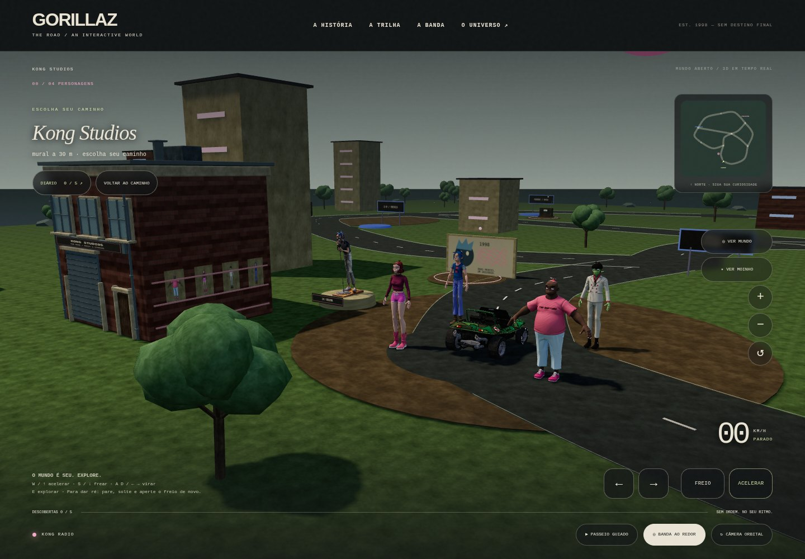
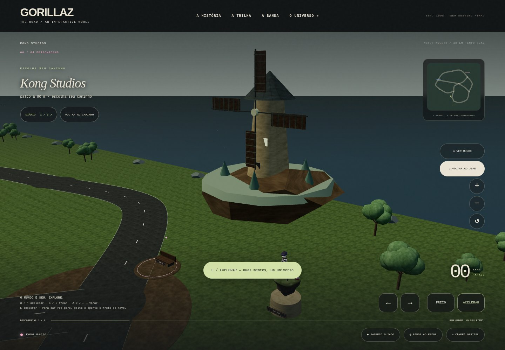
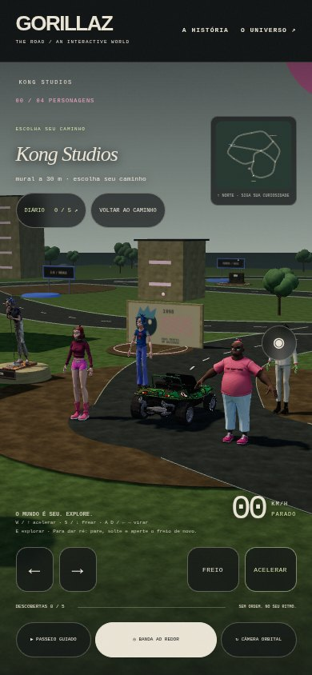

# Piloto visual — Kong Studios e anexos

Primeira etapa do plano visual, com fachada modelada, piso texturizado, árvores orgânicas, céu, mural autoral e peças enviadas pelo usuário. A direção livre, as cinco histórias e o conteúdo histórico continuam disponíveis.

## Resultado em jogo







Capturas do Chromium; a preferência por movimento reduzido foi usada para registrar câmeras estáveis. As imagens mostram a implementação, não um conceito renderizado à parte.

## Análise dos quatro arquivos

| Arquivo | Inspeção | Aproveitamento |
| --- | --- | --- |
| `gorillaz-sculpture.zip` | OBJ com 129.391 triângulos e fotografia de textura 8K; sem rig ou animação | Escultura de 2-D no pátio, reduzida para 33.999 triângulos e textura 1K; GLB de aproximadamente 1,5 MiB |
| `noodle.zip` | FBX com 306.208 triângulos; personagem, ilha e pequeno moinho; três materiais, sem rig ou animação | Diorama no mirante, reduzido para 48.000 triângulos e texturas 1K; GLB de aproximadamente 1,2 MiB |
| `2d-gorillaz-model-v2-study.zip` | Transferência recusada pela ferramenta porque excede 32 MiB | Conteúdo não acessado nem incorporado |
| `take-me-to-a-galaxy-far-away.zip` | Transferência recusada pela ferramenta porque excede 32 MiB | Conteúdo não acessado nem incorporado |

Os dois modelos incorporados funcionam como peças estáticas da exposição. Os integrantes Phase 7 continuam sendo os personagens dos encontros; não se atribuiu animação a malhas sem esqueleto.

A escultura corresponde ao scan [Gorillaz sculpture, publicado por Leam](https://sketchfab.com/3d-models/gorillaz-sculpture-cf1f323bba7d45ad8596eaa62ca60ce1), cuja página pública indexada informa CC Attribution e contagem compatível. A versão exata dessa licença não foi obtida.

O usuário indicou [a busca do Sketchfab](https://sketchfab.com/search?features=downloadable&q=gorilaz&type=models) como origem dos arquivos. A autoria e a licença individuais do arquivo Noodle ainda não foram confirmadas. A pesquisa de imagem encontrou [um candidato visual](https://sketchfab.com/3d-models/noodle-feel-good-inc-19a77b0fd5a14aa1a4b1f6e84af90ce7), mas a página retornou 403 e não estabeleceu correspondência técnica suficiente para atribuição. Nenhum crédito foi inventado.

Créditos e adaptações acompanham as peças em [CREDITS.txt](../assets/environment/CREDITS.txt). O [manifesto](../assets/environment/manifest.json) registra tamanhos, contagens e hashes.

## Melhorias desta etapa

- Fachada de Kong Studios com tijolos, portas, janelas, calhas, cobertura e bordas trabalhadas, exportada em poucos grupos de materiais.
- Vegetação modelada e texturizada, repetida com instâncias compartilhadas.
- Superfícies locais de asfalto, terra, grama, reboco, madeira e telhado; UVs das ruas acompanham a distância do trajeto.
- Cruzamentos com acabamento para reduzir linhas atravessando as junções.
- Descobertas com aparências distintas: mural, arquivo, rádio, banco do mirante e pequeno palco.
- Iluminação calibrada, céu ilustrado, sombras de contato e enquadramento do pátio.
- Colisores das novas peças e árvores; os cinco destinos continuam acessíveis.
- Geometrias estáticas de fundo agrupadas por material. Em uma comparação do mesmo enquadramento durante a implementação, o contador do renderer passou de 305 para 218 chamadas. Isso não constitui uma medição de FPS em aparelho físico.

## Materiais e reprodução

As superfícies, o mural, o céu, a fachada e a árvore são autorais deste projeto. O download de material da Poly Haven foi bloqueado pela rede; não se afirma que os recursos pesquisados no plano foram baixados ou incorporados.

Para reproduzir os assets autorais, com Blender disponível:

```sh
blender --background --disable-autoexec --python scripts/build-visual-environment.py
```

Os ZIPs originais e os arquivos de inspeção ficaram fora da pasta servida pelo jogo e do commit. Somente exportações reduzidas foram adicionadas. As imagens originais dos retratos Phase 7 são reutilizadas nos pôsteres, mantendo os créditos anteriores.

## Verificação e próximos passos

A sintaxe e os 39 testes passaram, incluindo validade dos novos GLBs, texturas incorporadas com até 1024 px, ausência de animações indevidamente declaradas e navegação aos cinco destinos.

A verificação de navegador cobre carregamento, interação, diário, controles móveis e alternativa de falha de uma peça decorativa. Não foi medida a fluidez em aparelho físico. O restante do plano visual — fachadas completas das outras áreas, costa, relevo dirigível e animações articuladas — permanece como evolução posterior ao piloto.
