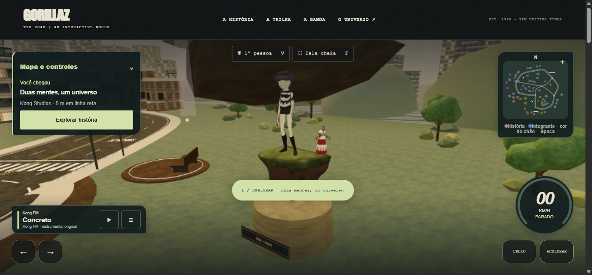
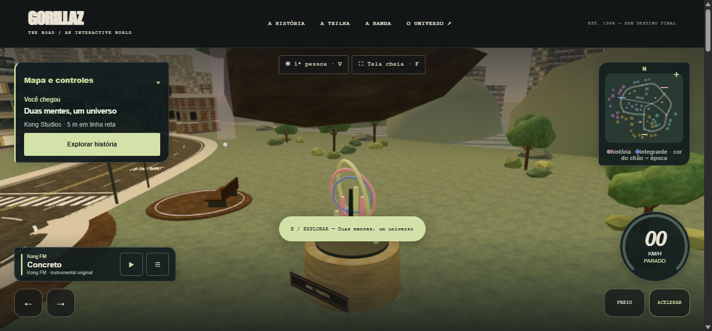

# GZ-05 — substituição local do diorama — 12/11/2026

**Resultado: peça substituída e validada na cena; saneamento de distribuição ainda parcial.** O processo compartilhado continua expondo a URL antiga e o GLB foi preservado em disco conforme o escopo. A árvore integral do projeto ainda não deve ser tratada como pacote liberado para redistribuição.

## Alteração

O diorama externo de origem/licença não comprovadas foi substituído pelo **Jardim de frequências**, composição geométrica estática criada nesta tarefa: três aros inclinados, sete barras de alturas diferentes e suporte circular. Não contém figura humana, personagem, ilha ou moinho nem reutiliza geometria/texturas do arquivo anterior. O tema é uma representação abstrata de frequências musicais.

- `src/environment.js`: exporta `createFrequencyGarden`, posiciona a peça no mesmo volume da exposição, retira o carregamento de `noodle-diorama.glb`, muda a placa para “JARDIM / FREQUÊNCIAS” e atualiza o status da exposição. A chave interna `VISUAL_LANDMARKS.diorama` e o dataset `data-diorama` foram mantidos para preservar o volume de colisão e compatibilidade de diagnóstico; não atribuem a nova peça a Noodle.
- `index.html`: remove o botão de download do diorama e acrescenta aviso de substituição, fora do bloco de créditos. O texto anterior de créditos permanece intacto; o único elemento modificado dentro desse bloco foi o controle de download, substituído por informação sem link.
- `server.mjs`: remove a rota pública do diorama para novas inicializações.
- `tests/server.test.mjs`: verifica que o diorama arquivado recebe 404 no novo servidor.
- `tests/frequency-garden.test.mjs`: verifica que a arte cabe no volume de colisão preservado, não usa texturas e fica abaixo de 1.500 triângulos.

Nenhum GLB ou arquivo de licença/crédito foi alterado, apagado ou movido. `src/app.js`, `src/content.js` e README principal, já existentes/alterados antes desta tarefa, também foram preservados byte a byte, conforme SHA-256 em `preserved-before.json` e `preserved-after.json`. O manifesto original conserva a procedência desconhecida do arquivo arquivado, sem sugerir licença nova. Não houve commit, push, publicação, submissão, instalação ou alteração do carro/integrantes.

## Números

| Item | Antes | Depois |
|---|---:|---:|
| Triângulos da peça, sem pedestal/placa comuns | 48.000 | 1.396 |
| Arquivo de modelo requisitado | 1.251.404 bytes GLB | Nenhum |
| Texturas próprias da peça | Embutidas no GLB | Nenhuma |
| Malhas da nova peça | — | 12 |
| Geometrias únicas / materiais da nova peça | — | 4 / 4 |
| Buffers de geometria únicos da nova peça | — | 19.432 bytes |
| Tamanho de `src/environment.js` | 5.881 bytes | 7.058 bytes |

A geometria nova é gerada pelo código local, sem arquivo de modelo novo. A redução de triângulos é de aproximadamente 97,1%; não foi medido ganho de FPS. Placa e pedestal mantêm os materiais existentes. O grupo novo é estático e usa o culling de frustum do Three.js; não precisa do retrato/impostor gerado para a malha antiga. Os números completos e tamanhos dos cinco arquivos tocados constam em `summary.json`.

## Antes e depois reais

Capturas realizadas no navegador OpenBot em `http://localhost:3000/?perf&qualidade=leve`, antes e depois de recarregar os arquivos alterados. Viewport 1345×635, canvas CSS 1345×543, drawing buffer 941×380, pixel ratio 0,7. Usou-se o diagnóstico `world.debug` já disponível para fixar a câmera em `(107,10,-131)`, olhando para `(97,5.3,-144)`, nos dois registros, sem mudar a posição do veículo.

São imagens reais do WebGL, sem edição ou composição. O HUD continua refletindo a posição anterior do veículo; a câmera de evidência não representa a câmera normal de condução. Na captura anterior, a malha do diorama foi explicitamente tornada visível e seu impostor ocultado apenas na instância do navegador: isso evita fotografar a face lateral do impostor distante. A primeira tentativa mostrou esse impostor de perfil; foi descartada. A câmera foi normalizada antes das duas capturas finais. O grande volume escuro no alto pertence ao cenário existente, fora da peça substituída; não foi modificado.

Verificação após recarregar: `frequency-garden` presente; antigo objeto `diorama` ausente; zero requisições de `noodle-diorama.glb`; zero links para o GLB no HTML; aviso e status novos presentes. Limites da nova peça no mundo: x 95,05–98,95; y 2,40–7,04; z −145,95–−142,05. O teste confirma que a projeção horizontal cabe no raio 2,8 existente.

## Validação

- `npm run check`: exit 0, log em `check.log`.
- `npm test`: exit 0; **45 testes passaram**, sem falhas ou skips; `test.log`.
- Regressão de distribuição: `regression-red.mjs` inicia uma cópia do servidor anterior em porta efêmera, usando os arquivos do projeto, e exige 404 para a URL antiga. Recebeu **200** e falhou como esperado (exit 1); `regression-red.log`. A mesma exigência passa no servidor novo dentro de `npm test`. O script encerra somente o subprocesso que criou.
- `git diff --check`: sem erro; Git avisou apenas conversão futura LF/CRLF em arquivos já sujeitos à política do checkout.
- `build-evidence.py` confirmou hashes preservados e que o bloco de créditos permaneceu idêntico exceto pelo controle de download. Gera `changes.diff` e `summary.json`.
- Servidor compartilhado: PID **19020**, início **12/11/2026 13:37:27**, preservado. Não foi parado nem reiniciado. A aba criada para capturas foi fechada ao terminar.

## Conflitos e pendências que impedem fechar o saneamento completo

1. **Rota no processo já iniciado:** seu mapa de rotas vive em memória. Alterar `server.mjs` não o recarrega. HEAD em `http://127.0.0.1:3000/assets/environment/noodle-diorama.glb` ainda retornou **200**, tamanho 1.251.404. A navegação nova não usa esse arquivo, mas quem conhece a URL ainda consegue obtê-lo nesse processo. Não foi contornada a proibição de reiniciar o servidor compartilhado. Para aplicar o bloqueio na porta 3000, Eduardo precisa autorizar/executar reinício em janela adequada; após isso, confirmar 404.
2. **Arquivo arquivado dentro da árvore:** `assets/environment/noodle-diorama.glb` foi preservado com hash original. O bloqueio HTTP não o exclui de um ZIP/clone da árvore integral. A coordenação deve definir um pacote final que não o inclua, ou autorizar sua transferência para arquivo privado fora da distribuição. Nenhuma mudança de histórico/remoção foi feita nesta tarefa.
3. **Textos históricos de crédito:** `index.html` ainda contém “O diorama da Noodle vem de uma publicação do Sketchfab…” e “As peças foram reduzidas…”. Isso agora descreve a etapa anterior, não a cena atual. Um aviso visível antes do bloco informa a substituição e a preservação dessa descrição para revisão. README principal (`Estrutura`, `Modelos densos ao longe`), `assets/environment/CREDITS.txt`, `manifest.json`, `docs/PILOTO-VISUAL.md` e documentos anteriores também descrevem a versão antiga. Não reescrevi atribuições/licenças para resolver a inconsistência, pois o pedido proíbe alterações nesses arquivos/textos. É necessária autorização específica para atualizar a apresentação editorial dos créditos, preservando a trilha histórica em evidência.

O teste legado `environment.test.mjs` ainda valida fisicamente o GLB arquivado; isso **não** comprova licença nem significa que ele continue integrado à cena. A nova regra de servidor e a inspeção de requisições verificam separadamente a retirada de uso.

## Análise antes do código e limites

Stack: JavaScript/HTML, Three.js r180, Node e node:test; sem banco de dados.

1. Volume: peça de tamanho fixo, 12 malhas e quatro geometrias compartilhadas, sem acumulação por histórico.
2. Consumidores: verificados carregador/status/placa, volume compartilhado, botão de download, rota HTTP, testes e referências editoriais.
3. Irmãos: preservada escultura de 2-D e sua atribuição; status geral distingue a nova obra original.
4. Bordas/entrada externa: não há novos campos ou entradas; geometria fica dentro do volume fixo existente. Sem alteração de data, persistência, física ou progresso.
5. Limite real: substituição visual e rota futura verificadas; não é liberação jurídica da árvore nem bloqueio do processo antigo.

Não foram medidos FPS, aparelhos físicos, primeira pessoa, percurso completo nem renderização em outros navegadores. O teste geométrico e o percurso automatizado já existente passaram; isso não substitui revisão visual de todas as câmeras. Apenas esta pasta de evidência, cinco arquivos listados no diff e capturas/ZIP/cópias de entrega no workspace do agente foram escritos. Referência da decisão: `../GZ-05-diorama-noodle-origem-licenca-2026-11-12.md`.
