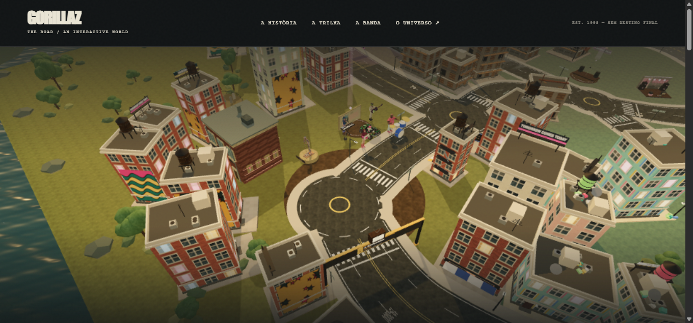
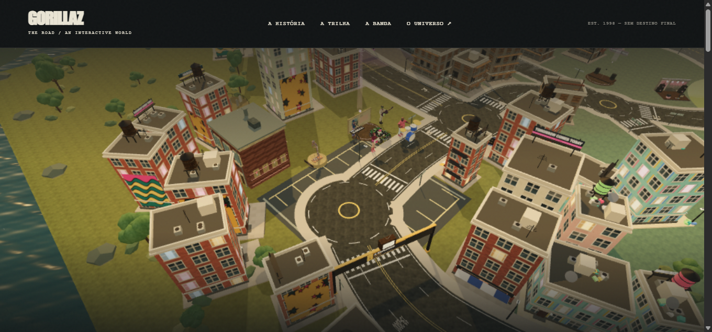
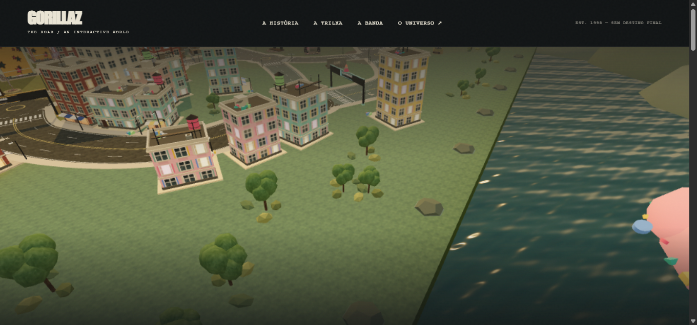
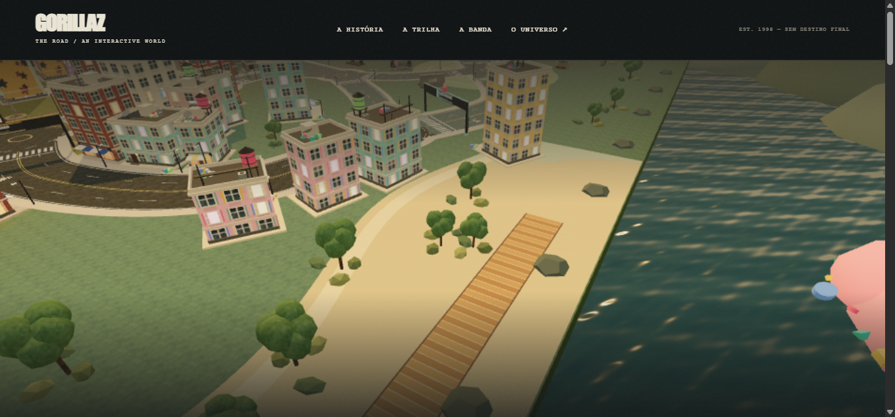
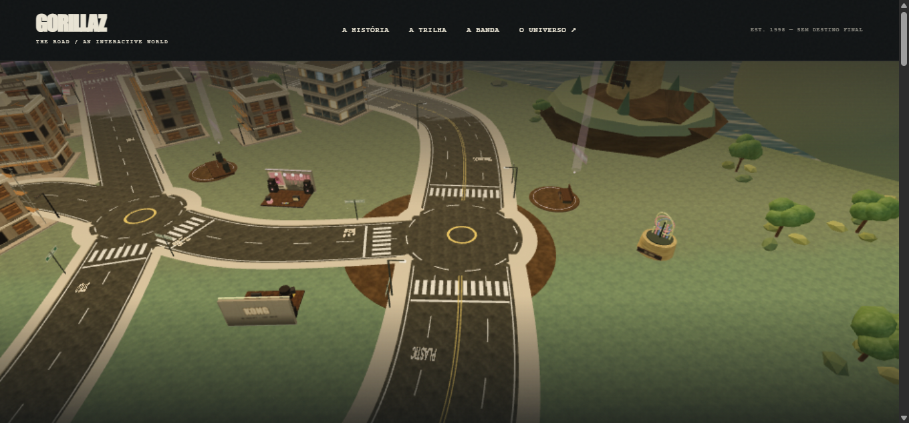
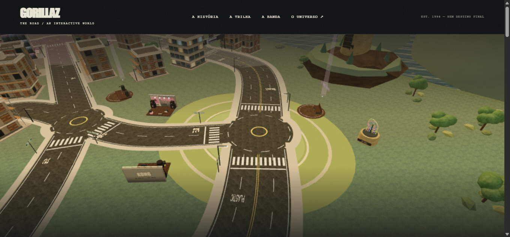

# GZ-08 — diferenciação visual local — 12/11/2026

**Implementado e validado:** estúdio, costa leste e mirante receberam acabamentos de piso distintos, dentro do terreno que já existia. Nenhuma região, rua, descoberta, obstáculo ou extensão navegável foi acrescentada. GZ-09 não foi iniciado.

## Escopo

- **Estúdio:** pátio cinza-escuro com faixas de organização e bordas claras, em torno da praça de Kong Studios. A aparência industrial diferencia a entrada urbana do restante do gramado.
- **Costa leste:** faixa de areia clara com contorno ondulado, outra faixa de duna e tábuas rasas em tons de madeira junto à margem. O acabamento aproxima visualmente a área do mar existente, sem ampliar o chão nem criar cais sobre a água.
- **Mirante:** gramado mais claro e duas trilhas elípticas, ao redor da praça próxima do moinho. O desenho cria uma área aberta de passeio, diferente do pátio do estúdio.

É uma mudança **de acabamento de piso**, não uma reformulação dos edifícios, biomas, relevo, iluminação ou navegação. O mapa continua com as três regiões anteriores: Kong Studios, Bairro dos murais e Mirante do moinho. “Costa” identifica aqui um tratamento local na faixa leste, não uma nova região do diário ou um novo ato histórico.

## Arquivos e arquitetura

- `src/environment.js`: novo gerador puro `createRegionalGrounds()`, chamado uma vez em `installEnvironment`. Produz `regional-grounds` com três malhas estáticas, uma por local, e um material compartilhado com cores por vértice. Nenhuma imagem, textura, GLB, dependência ou rota de servidor foi adicionada.
- `tests/regional-grounds.test.mjs`: valida os limites do terreno existente, a altura abaixo das ruas, normais voltadas para cima, ausência de texturas, orçamento de triângulos e material compartilhado.
- `changes.diff`: diff **somente desta tarefa**, comparado ao snapshot de `environment.js` que já incluía GZ-05. Não inclui as alterações anteriores de GZ-03, editorial ou substituição do diorama.

Preservados byte a byte, por SHA-256: `index.html`, `server.mjs`, `src/app.js`, `src/content.js`, `src/world-data.js`, `src/scene.js`, `src/city.js`, README principal, créditos e manifesto do ambiente, diorama arquivado e testes de GZ-05. Evidência em `preserved-before.json` e `preserved-after.json`; `build-evidence.py` também compara os hashes com os arquivos atuais.

O projeto já tinha modificações nesses arquivos e documentação não rastreada. Nenhuma delas foi revertida. O novo grupo mantém o Jardim de frequências da etapa anterior; a navegação de verificação continuou sem requisitar o diorama antigo.

## Custo e limites geométricos

| Acabamento | Triângulos adicionais | Buffers de posição, cor e normal |
|---|---:|---:|
| Estúdio | 38 | 4.104 bytes |
| Costa | 212 | 22.896 bytes |
| Mirante | 288 | 31.104 bytes |
| Total | **538** | **58.104 bytes** |

São três malhas, um material e zero texturas novas. Isso pode acrescentar até três chamadas de desenho na passagem principal quando todas estiverem visíveis; não lançam sombras, mas recebem a sombra existente. Não foi medido impacto de FPS nesta tarefa. `environment.js` passou de 7.058 para 9.925 bytes em disco; tamanho comprimido e tempo de geração não foram medidos.

Os vértices ficam entre y −0,115 e −0,101; o asfalto existente está em −0,09, portanto as ruas e sua pintura continuam acima dos novos pisos. Os acabamentos não criam colisores ou degraus de física. As superfícies ficam dentro do chão visual que já existia (x −140 a 140; z −200 a 50). A areia chega a x 139,8, dentro dessa geometria: isso **não** muda o limite navegável do veículo, que continua em x ±135 e z −195 a 45. A costa não expande o mar ou a ilha.

Os pisos têm paletas próprias e cobrem parte da tintura de era dentro dessas pequenas áreas; os dados dos atos, rótulos, minimapa e tintura do entorno continuam como antes. A madeira é um acabamento decorativo: não define uma nova rota de navegação. Árvores e pedras anteriores foram mantidas, inclusive as próximas às tábuas. Não foi prometida alteração de aderência; o piso fora das ruas continua seguindo a física de terreno existente.

## Capturas reais antes/depois

As seis imagens foram capturadas no navegador OpenBot em `http://localhost:3000/?perf&qualidade=leve`, antes e depois de recarregar os arquivos atualizados. São renders reais, sem edição, montagem ou geração de imagens. O estilo foi construído com geometria/cor em código nesta tarefa, sem material artístico novo de terceiros.

Usou-se `world.debug`, já existente, para fixar as câmeras e o pixel ratio. O HUD foi ocultado **apenas na instância do navegador**, por CSS temporário, para inspecionar os pisos sem sobreposição. Esse CSS não foi gravado no produto. A posição do veículo não foi alterada. A câmera de evidência é elevada e não representa a câmera normal de condução. A primeira tentativa do estúdio ficou obstruída por prédios; foi descartada antes de qualquer edição, e o par final usa a câmera abaixo.

Viewport 1345×635; canvas CSS 1345×543; drawing buffer 941×380; pixel ratio 0,7, nos seis registros. Mesma câmera e alvo dentro de cada par:

| Local | Câmera | Alvo |
|---|---|---|
| Estúdio | (36, 58, 35) | (−4, 0, −5) |
| Costa | (145, 40, 35) | (116, 0, −15) |
| Mirante | (110, 42, −83) | (72, 0, −123) |

### Estúdio

### Costa

### Mirante

Nuvens, animações e sombras preexistentes não foram congeladas em um tempo comum; podem variar entre os recarregamentos. O enquadramento e o tamanho do canvas foram fixados. A verificação após recarregar confirmou os três nomes de malha e zero requisições de `noodle-diorama.glb`.

## Validação

- Antes de implementar o gerador: `node --test tests/regional-grounds.test.mjs` falhou (exit 1) por ausência de `createRegionalGrounds`, registrando a condição anterior em `regression-red.log`.
- Após a mudança funcional: `npm run check`, **exit 0**, log completo em `check.log`.
- Após a mudança funcional: `npm test`, **exit 0, 46/46 aprovados**, sem falhas ou skips; `test.log`. Inclui condução, descobertas, navegação, servidor e GZ-05.
- `git diff --check`: sem erros; somente os avisos prévios de futura conversão LF/CRLF no checkout.
- Servidor compartilhado PID **19020**, início **12/11/2026 13:37:27**, preservado sem reinício. O teste de servidor cria e encerra apenas seu subprocesso em porta efêmera.

## Análise antes do código

Stack: JavaScript, Three.js r180, HTML e Node/node:test; sem banco de dados.

1. Volume: geração única e limitada a 538 triângulos; sem histórico, listeners ou animação novos.
2. Consumidores: integração apenas pelo instalador do ambiente, já servido pela rota existente; mapa, física, diário e navegação preservados por hash e testes.
3. Irmãos: os três locais são construídos pelo mesmo gerador/material; não se aplicou identidade nova ao Bairro dos murais ou aos atos.
4. Bordas: teste de chão visual e altura abaixo das ruas; limites físicos e dados externos não mudam.
5. Limite real: acabamento visual de três áreas, verificado em um Chromium desktop e em câmeras diagnósticas. Não é uma validação de aparelhos físicos ou um ganho de performance medido.

## Limitações e continuidade

Não foram validados Android físico, outros navegadores, primeira pessoa, todos os ângulos de câmera ou teste prolongado de sobreposição/flicker. Os testes de navegação passaram e as capturas mostram as ruas preservadas, mas isso não substitui o passeio visual de QA em aparelho real. A leitura de cada área ao dirigir precisa da validação de usuário; estas imagens elevadas demonstram o escopo aplicado.

As pendências de distribuição e créditos históricos registradas em GZ-05 permanecem: não foram alteradas nesta tarefa. Não houve instalação, alteração de créditos/licenças, commit, push, publicação ou submissão. Não foi iniciado GZ-09.

Escritas desta tarefa: `src/environment.js`, novo teste, esta pasta de evidências e cópias de capturas/ZIP no workspace do agente. A aba de captura foi fechada ao terminar. O script `build-evidence.py` reproduz o diff, os números de geometria e a checagem dos hashes preservados.
