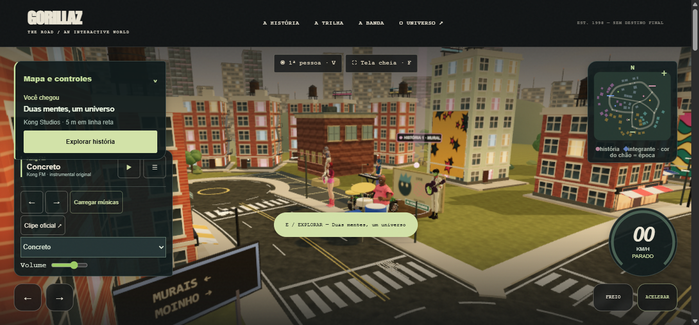
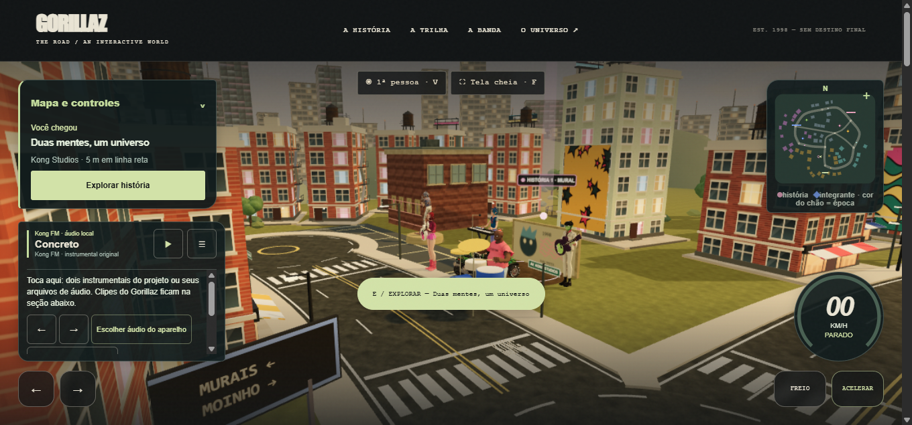
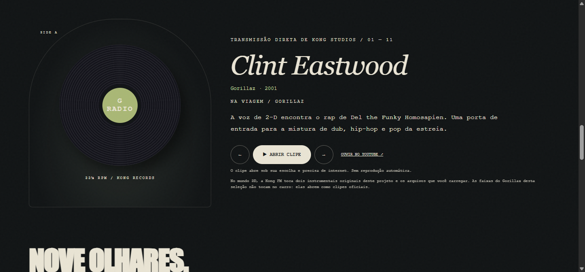
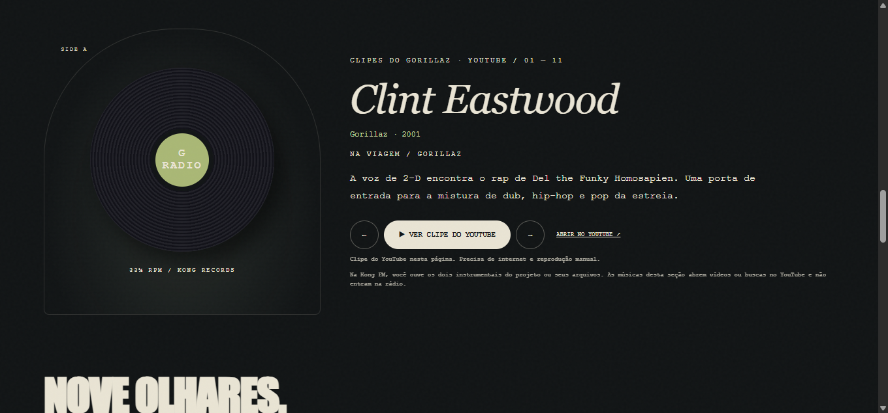
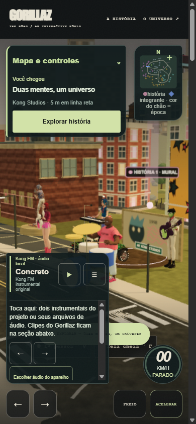
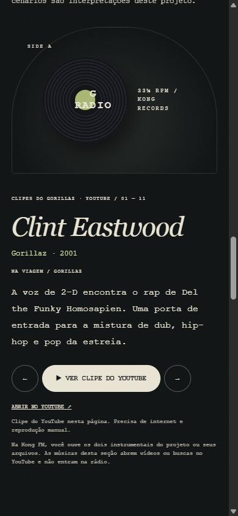

# GZ-09 — Kong FM e clipes externos — 12/11/2026

**Concluído:** a interface distingue o áudio da Kong FM dos vídeos/buscas do YouTube. A reprodução, os arquivos de áudio e os IDs/fontes dos vídeos permanecem como antes.

## Mudanças

| Controle | Apresentação nova | Ação real |
|---|---|---|
| Rádio do carro | “Kong FM · áudio local”; tocar/pausar com nome acessível e tooltip específicos | Reproduz instrumentais do projeto ou arquivos escolhidos no aparelho |
| Importação | “Escolher áudio do aparelho” | Mantém o seletor local e os Object URLs existentes; não envia arquivo ao servidor |
| Lista da rádio | “Escolher e tocar áudio na Kong FM” | Mantém a seleção/reprodução da rádio |
| Atalho no menu da rádio | “Ver clipes do Gorillaz ↓” | Vai à seção `#radio` da mesma página; não toca áudio nem abre vídeo sozinho |
| Seção editorial | “CLIPES DO GORILLAZ · YOUTUBE” | Apresenta a seleção de músicas já cadastrada |
| Faixa com player cadastrado | “VER CLIPE DO YOUTUBE” e aviso de player nesta página, internet e reprodução manual | Insere o iframe YouTube já existente; fechar retorna ao rótulo correto |
| Link externo da faixa | “ABRIR NO YOUTUBE ↗” | Mantém o destino externo em nova aba |
| Faixa sem player cadastrado | “BUSCAR NO YOUTUBE ↗” e aviso de busca em nova aba | Mantém a busca externa existente, sem fingir player disponível |

O texto estático da rádio passou a começar com **Concreto / instrumental original**, em vez de mostrar Clint Eastwood antes da inicialização JavaScript. O aviso final da seleção agora distingue vídeos de buscas, sem afirmar que todos os resultados da busca seriam clipes oficiais.

Os erros de áudio local deixam de sobrescrever `#track-status`, que descreve o vídeo. Agora usam um elemento próprio, `#road-radio-status`, com `role=status`, no painel da Kong FM. Quando vazio, não ocupa espaço. A conexão do canal de erro foi conferida por leitura do código; não foi forçado um arquivo inválido nesta sessão.

## Arquivos e escopo preservado

- `index.html`: rótulos, notas, metadados iniciais da rádio e elementos de ajuda/status. Nenhuma alteração na parte dos créditos ou nos textos históricos do projeto.
- `src/app.js`: textos de vídeo/busca e retorno após fechar; conexão do status da rádio; montagem da ajuda no menu; retirada da reatribuição do atalho da rádio para uma faixa externa não relacionada ao instrumental que toca.
- `src/local-radio.js`: nomes acessíveis da seleção e do botão de tocar/pausar; tooltip do botão. Não altera listas, URLs, volume, preload ou lógica de reprodução.
- `src/world.css`: ajuda/status e altura máxima com rolagem do menu. O limite evita que a ajuda adicional esconda o cabeçalho da rádio atrás do roteiro. O atalho para os clipes também fica disponível no menu móvel, antes ocultado por uma regra antiga.

O atalho dentro do HUD mudou intencionalmente de navegação direta ao vídeo selecionado para navegação interna à seção que explica os clipes. Os botões de vídeo e links externos dessa seção mantêm seus destinos e funcionamento anteriores. Não foi adicionada pausa automática de uma fonte ao abrir a outra: as fontes continuam independentes; o usuário controla cada reprodução.

`changes.diff` compara os quatro arquivos com snapshots feitos **antes desta tarefa**, preservando as alterações anteriores. `src/content.js`, `src/environment.js` (GZ-05/GZ-08), `scene.js`, `world-data.js`, servidor, README principal, créditos/manifesto e testes anteriores foram preservados por SHA-256. `build-evidence.py` confirma também que a cauda HTML desde `id="backstage"` não mudou e que o rótulo de ato espacial do diário permanece intacto. Ver `preserved-before.json`, `summary.json` e `verification.log`.

Durante a sessão o HEAD observado passou a `181eece90286f87d8d8c7cd91c6eb3097810a49e` (“Substitui diorama de Noodle e alinha regiões e créditos”). Este agente não criou commits; os hashes protegidos continuaram iguais. O diff desta entrega continua restrito às mudanças de GZ-09 sobre os snapshots.

## Capturas reais

Desktop: viewport de captura 1345×635, DPR 1. Em cada par, mesmo estado da interface: HUD com menu da rádio aberto e Concreto selecionado, ou seção dos clipes com Clint Eastwood e player fechado. A seção editorial foi alinhada ao início com `scrollIntoView`; scroll observado 2144 px antes/depois. Não houve edição, montagem ou ocultação de elementos. O cenário 3D e as animações de fundo podem variar entre recarregamentos.

As imagens seguintes são verificação adicional **depois**, sem par anterior móvel. Viewport solicitada 390×844; superfície capturada com 375 px de conteúdo. `innerWidth=390`, `documentElement.scrollWidth=375`, sem transbordamento horizontal observado. Isso é emulação de tamanho no mesmo Chromium desktop, não teste em Android físico.

O menu usa rolagem interna para manter o cabeçalho legível. Em desktop, o painel da rádio começou em y=331 e o roteiro terminou em y=312, sem se sobreporem nessa configuração; a primeira revisão do menu, mais alta, escondia parte do cabeçalho e foi ajustada antes da captura final. Controles mais abaixo, como lista/volume/atalho, podem exigir rolagem. Em móvel o menu tinha aproximadamente 159 px de altura. O atalho foi alcançado e acionado com sucesso.

## Verificação funcional

1. Após carregar, botão “Tocar Kong FM aqui” e nenhum iframe de vídeo; a abertura da página não iniciou vídeo.
2. Clique em tocar iniciou o estado de reprodução de **Concreto**: evento de áudio atualizou o botão para “Pausar Kong FM” e símbolo de pausa; nenhum iframe foi criado; aviso do clipe ficou intacto. Clique em pausar restaurou “Tocar Kong FM aqui”. Não foi avaliada a qualidade do som por audição.
3. “VER CLIPE DO YOUTUBE” inseriu `https://www.youtube-nocookie.com/embed/1V_xRb0x9aw`, sem parâmetro de autoplay, e mudou para “FECHAR CLIPE”. Fechar removeu o iframe e restaurou o rótulo de abertura.
4. Ao avançar para **Revolving Doors**, sem vídeo cadastrado, botão/aviso passaram a indicar busca externa. Clique abriu nova aba com `https://www.youtube.com/results?search_query=Gorillaz+Revolving+Doors+official`; a página do projeto continuou aberta e sem iframe. A busca exibiu resultados.
5. O atalho “Ver clipes do Gorillaz ↓”, também visível no menu móvel, levou a `#radio`, com o cabeçalho “CLIPES DO GORILLAZ · YOUTUBE”, sem iniciar mídia.

## Check, testes e ambiente

- Após a última alteração: `npm run check`, exit 0, `check.log`.
- Após a última alteração: `npm test`, exit 0, **46/46 passaram**, sem skips/falhas; `test.log`.
- `git diff --check`: sem erros; somente avisos de futura conversão LF/CRLF em app/CSS.
- Não foram acrescentados testes unitários que apenas comparassem rótulos. A verificação específica desta tarefa foi feita nos controles reais do navegador, além da suíte existente.
- A primeira tentativa de extrair trechos HTML por um comando Python teve erro de aspas do shell; foi substituída pela leitura de linhas. O primeiro log de `build-evidence.py` falhou ao imprimir o símbolo de play no terminal CP1252; o arquivo JSON já havia sido escrito. A impressão foi corrigida para ASCII escapado e a verificação foi repetida com sucesso. Esses erros não atingiram o produto.
- Servidor ativo na conferência final: porta 3000, PID **22696**, início **12/11/2026 15:16:30**. O PID 19020 do contexto anterior já não existia. Este agente não iniciou, parou ou reiniciou o servidor compartilhado. HTTP HEAD `/` e `/src/app.js` retornaram 200. A URL antiga do diorama retornou 404 nesse processo atual — observação adicional, sem alterar GZ-05 nesta tarefa.
- O teste de servidor usa sua própria porta efêmera e encerra somente seu subprocesso. Nenhuma instalação, commit, push, publicação ou submissão foi feita.

## Limites

A busca do YouTube carregou, mas recursos `googlevideo.com` e `doubleclick.net` produziram `ERR_NAME_NOT_RESOLVED`; uma fonte externa teve `ERR_CACHE_MISS`. Não se confirmou reprodução completa de vídeo nem se alterou rede/configuração para contornar esses erros. No iframe também apareceram avisos de fonte lenta, precedência de `allow` sobre `allowfullscreen` e preferência de GPU ignorada no Windows. Nenhum desses avisos motivou mudança de fonte/ID ou reprodução automática.

Não foram testados importação de arquivo real, arquivo inválido, controles 3D do rádio na cabine, leitor de tela, Android físico ou outros navegadores. Os controles 3D continuam usando a mesma rádio e não receberam nova arte ou funcionalidade. A compreensão por uma pessoa nova ainda precisa de validação de UX; aqui foram conferidos os textos e seus destinos reais.

Escritas: quatro arquivos do produto, esta pasta de evidências e capturas/cópias/ZIP no workspace do agente. A navegação criou histórico local no navegador e uma busca no YouTube por Revolving Doors; não houve envio de formulário de mensagem, upload de arquivo, mudança de conta ou reprodução solicitada do vídeo externo. As abas criadas para verificação foram fechadas ao terminar.

Stack: JavaScript/HTML/CSS, Three.js local e Node/node:test, sem banco. Coleções de faixas permanecem limitadas às entradas e aos arquivos escolhidos pelo usuário; nenhum novo acúmulo ou listener foi introduzido. Consumidores conferidos: tocar/pausar, selecionar faixa, abrir/fechar player, busca sem player, atalho do HUD e status. Não houve alteração de progresso, datas, roteamento do servidor ou material creditado. A skill `ux-copy` orientou a distinção entre ação local, player externo incorporado e nova aba.
