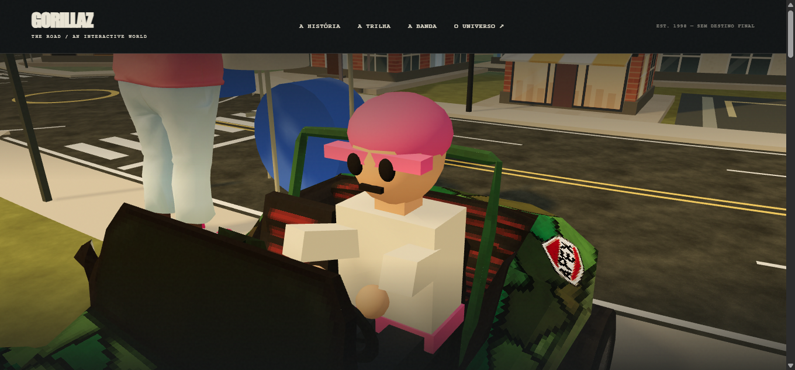
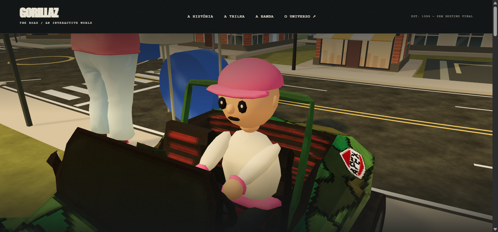

# Ocupante do Geep — 12/11/2026

Plano aprovado por Eduardo via maricota. **Implementação concluída**, com limites de validação de navegador descritos abaixo. Mudanças de produto restritas a `src/scene.js`; novo teste em `tests/driver.test.mjs`. `cabin.js` não precisou mudar.

## Geometria e origem

O ocupante continua sendo um personagem genérico original, construído em código com primitivas geométricas, na identidade rosa e creme já existente. Não foi importado personagem, malha, imagem, textura, GLB ou referência artística de terceiros. A biblioteca Three.js existente e os materiais já usados pelo projeto foram reaproveitados; suas licenças/créditos não mudaram.

Tronco, cintura, pescoço, pernas, braços e mãos usam esferas/elos arredondados de poucos segmentos. Rosto ganhou nariz, orelhas, sobrancelhas e pequenos brilhos nos olhos; o boné tem copa hemisférica e aba arredondada. As partes estáticas são fundidas por material em três conjuntos: corpo, cabeça e braços. Não há nova geometria ou material sendo criado por quadro.

| Medida do ocupante externo | Antes | Depois |
|---|---:|---:|
| Triângulos | 1.428 | **2.228** |
| Malhas após agrupamento | 17 | **11** |
| Buffers de geometria únicos | 44.472 bytes | 69.752 bytes |
| `src/scene.js` em disco | 71.011 bytes | 74.472 bytes |
| Novo GLB/textura/biblioteca | — | **Nenhum** |

O aumento foi de 800 triângulos; o resultado fica 772 abaixo do limite de 3.000. As malhas passaram de 17 para 11; não foi medido ganho de FPS. Há cinco materiais de cor, reaproveitados pelo cache existente. `summary.json` e `build-evidence.py` reproduzem a contagem.

Escala 1,22 e encaixes preservados: cabeça `(0,2.24,.02)`, braços `(0,1.62,-.5)`, mãos nos pontos anteriores `(±.19,0,0)` do grupo dos braços. Os elos dos braços foram alinhados a esses punhos, mantendo as mãos apoiadas em vez de fazer gesto de aceno. A instalação do modelo real ajusta o corpo ao mesmo banco/volante de antes; a posição final foi idêntica nas duas capturas. O código de construção e instalação do carro foi comparado e permaneceu igual.

## Reação e controles

- Cabeça faz uma inclinação/virada breve de **0,8 segundo**, contada por tempo absoluto, e volta ao repouso. Não há animação de mãos/corpo nesse gesto.
- Hover do mouse só dispara ao entrar na cabeça; não se repete continuamente enquanto o cursor permanece nela. Clique/toque usa o caminho de `click` após o gesto de ponteiro.
- Só é permitido com velocidade absoluta até **0,05 unidade/s**, tolerância de repouso menor que a usada para condução visível. Movimento para frente/ré ou preferência de movimento reduzido bloqueiam e cancelam a reação.
- Pressionar para arrastar cancela a reação. Deslocamento acumulado maior que quatro pixels CSS impede que o clique final seja interpretado como toque no personagem. Os deltas/origem e os controles anteriores da câmera continuam intactos.
- Em primeira pessoa e vista aérea, não há ação de cabeça. A ocultação do ocupante externo em primeira pessoa foi preservada; os braços existentes da cabine continuam sendo os que aparecem nessa vista.
- Não há biblioteca de colisão, BVH, rig ou textura nova. O hit test reutiliza o raycaster e o throttle de hover existentes, mirando apenas a cabeça.

## Antes e depois reais, mesma câmera

Navegador OpenBot, `http://localhost:3000/?perf&qualidade=leve`. Viewport 1345×635; canvas 1345×543; pixel ratio 1; FOV 35. Câmera no espaço do motorista `(-1.45,2.95,-2.25)`, alvo `(0,1.9,-.02)`. Nos dois registros, a câmera no mundo foi `(-15.4426961091,4.0970833389,-22.9171589661)`; escala e posição do personagem no banco iguais.

Para inspecionar o ocupante, o HUD foi ocultado por CSS temporário e a câmera foi fixada usando `world.debug`, já existente. Essas mudanças não foram gravadas no produto. Ambas as imagens mostram a cena real completa, sem edição ou composição, com a cabeça em repouso. Os modelos do Geep e da banda ao fundo são os assets preexistentes, não fazem parte da criação do personagem desta tarefa. Nuvens/animações de fundo podem variar entre os recarregamentos.

## Validação

- Antes de implementar: novo teste falhou porque as funções não existiam (`regression-red.log`, exit 1).
- Depois da mudança funcional: `npm run check`, **exit 0**; `check.log`.
- Depois da mudança funcional: `npm test`, **exit 0, 49/49 passaram**; `test.log`. Três testes novos verificam orçamento/encaixes/material, duração sem acúmulo e bloqueio/cancelamento por movimento e movimento reduzido.
- `git diff --check`: sem erros.
- Hashes confirmam preservação de Geep GLB, `cabin.js`, app, conteúdo, ambiente de GZ-05/GZ-08, rádio de GZ-09, mundo, CSS, servidor, README principal e arquivos de créditos/manifesto. O script também compara os blocos de construção e instalação do veículo dentro de `scene.js` com o original. A versão anterior do arquivo está em `baseline/scene.js`.

### Interações no navegador e limitação da emulação

No fluxo natural do app, o navegador retornou `prefers-reduced-motion: reduce = true`, e o hover real não produziu reação — comportamento esperado. Duas tentativas de emular `reducedMotion=false` mantiveram o inventário da aba em `false`, mas `matchMedia` nativo da página continuou retornando `true`. Portanto **não foi validado um hover completo no fluxo natural com a preferência normal**.

Para testar os handlers sem alterar o produto ou a preferência do usuário, foi montada uma fixture temporária na aba: a API diagnóstica da cena recebeu `reduced=false`, objetos de fundo e sombras foram ocultados apenas nessa fixture e a renderização original foi suprimida. A cabeça foi amostrada por timers chamando a atualização da cena nos tempos correspondentes, porque poucos frames por segundo podiam pular toda a janela de 0,8 segundo. Isso é um teste diagnóstico da cena, não uma medição de performance nem prova de movimento suave no hardware final.

Com entrada de mouse **real/confiável do navegador** nessa fixture:

- Hover: inclinação máxima amostrada de 0,1184 rad e virada de 0,2369 rad; aos 1.059 ms os três eixos estavam em zero. Braços ficaram com rotação zero em todas as amostras.
- Clique: mesma reação; aos 1.059 ms voltou a zero. Braços imóveis, nenhum diálogo aberto.
- Arraste de 12 pixels sobre a cabeça: foram observados ponteiros confiáveis com botão pressionado, click final, câmera original alterada e cabeça em zero depois de soltar. O helper de drag retornou “The source did not start a native drag operation”, pois o canvas não iniciou drag HTML; a leitura posterior confirmou que o gesto de ponteiro foi entregue e processado pela câmera. Não se presumiu sucesso pelo retorno da ferramenta. Uma tentativa anterior de usar `drag` dentro de `run_script` foi rejeitada por ação não suportada e não efetuou o gesto; o tool dedicado foi usado em seguida.
- API de primeira pessoa: `driver.visible=false`, `cabin.visible=true`. Nenhuma mudança necessária no arquivo da cabine.

Resultados condensados em `interaction-results.json`. Estados de visibilidade, renderer, câmera e atualização originais foram restaurados após a fixture; a aba foi fechada ao terminar. O feedback sobre a emulação do OpenBot foi tentado, mas a ferramenta recusou envio por se tratar de mensagem de colega, não mensagem humana. Não foi aberta issue por outro meio.

## Limites e entrega

Não houve Android/toque físico, leitor de tela, todos os ângulos, validação prolongada de interseções com carro/volante ou benchmark de FPS. Clique foi verificado; toque compartilha o handler, mas requer validação no aparelho. Em uma taxa de quadros muito baixa, a reação curta pode ser pouco perceptível ou não ter quadro intermediário. O teste da preferência reduzida passou no controlador e no fluxo real, mas a preferência normal depende da limitação diagnóstica acima.

Só `src/scene.js`, o teste novo e esta pasta foram escritos no projeto. Capturas, cópias e ZIP de entrega também foram gravados no workspace do agente. Nenhum modelo original foi removido: o ocupante anterior era procedural, e seu código está no snapshot; Geep GLB preservado. Nenhum crédito/licença foi alterado. Sem instalação, commit, push, publicação, submissão ou reinício do servidor. Servidor observado: PID 22696, início 12/11/2026 15:16:30.

Na conferência final, `docs/gestao/MODELOS.md` apareceu alterado fora desta tarefa. Não foi editado, revertido nem incluído no diff desta entrega.

Análise antes do código: stack JavaScript/Three.js e Node/node:test, sem banco; geometria e estado de reação limitados, sem crescimento por histórico; consumidores de criação, instalação do veículo, hover/click, arraste, curva e primeira pessoa conferidos; cabeça isolada dos braços; mesmos encaixes e mesma tolerância em hit test/controlador. A reação é decorativa e não muda posição, colisão, progresso, narrativa ou áudio.
