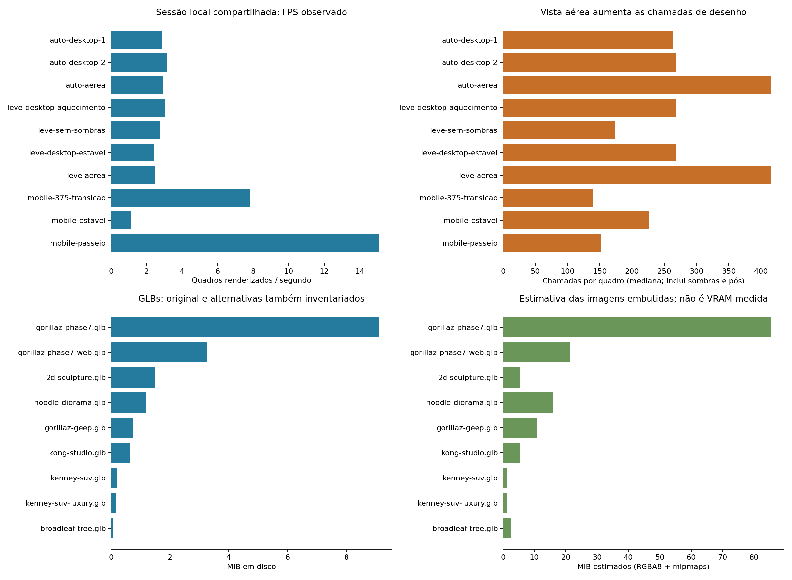
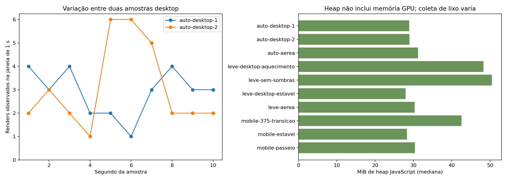
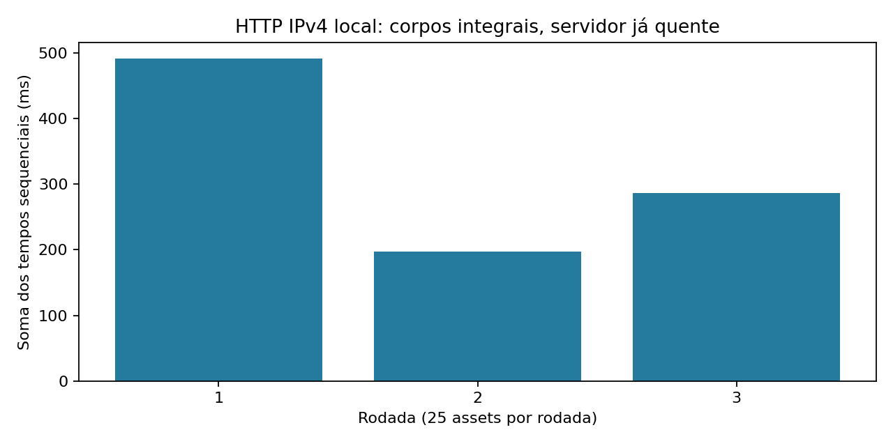

# Performance — Gorilazz — 12/11/2026

Análise local concluída, com limitações de ambiente. Há carga gráfica relevante, mas esta sessão não permite atribuir o FPS baixo exclusivamente ao projeto nem comprovar uma otimização segura. Nenhum arquivo de produção foi alterado nesta tarefa. As recomendações abaixo precedem qualquer futura alteração.

## Resultado medido

| Cenário | FPS observado | Intervalo p95 | Chamadas/quadro (min–máx) | Triângulos/quadro (min–máx) |
|---|---:|---:|---:|---:|
| Desktop automático, parado, amostra 1 | 2,90 | 537 ms | 174–268 | 258.670–453.954 |
| Desktop automático, parado, amostra 2 | 3,15 | 537 ms | 174–268 | 258.670–453.954 |
| Desktop automático, vista aérea | 2,95 | 537 ms | 321–415 | 324.746–520.030 |
| Desktop leve, parado, estabilizado | 2,42 | 537 ms | 174–268 | 258.670–453.954 |
| Desktop leve, sem sombras, experimento isolado | 2,77 | 535 ms | 174 | 258.670 |
| Desktop leve, vista aérea | 2,46 | 536 ms | 321–415 | 324.746–520.030 |
| Viewport móvel, parado após adaptação | 1,12 | 1.005 ms | 132–226 | 218.715–413.999 |
| Viewport móvel, passeio até a primeira história | 15,06 | 101 ms | 102–217 | 99.384–197.625 |

FPS = quadros renderizados por segundo; p95 = intervalo que contém 95% dos intervalos observados. Poucos quadros nas amostras lentas tornam percentis pouco robustos. As chamadas incluem passes de sombra, pós-processamento e espelho quando ativo, não apenas objetos visíveis. Sombras em quadros alternados explicam parte da diferença entre mínimos e máximos.

## Metodologia e ambiente

- Base: HEAD `544f3f9306bfe77fe3577ea25b95816f1c683343`, com alterações anteriores em `src/app.js` (diário) e `src/content.js` (editorial), ambas preservadas. Árvore já continha `docs/gestao/` não rastreado.
- Windows; Ryzen 5 4600G, 12 processadores lógicos; ANGLE AMD Radeon RX 6700 XT / Direct3D11; Chromium 152.0.7977.167. O valor `deviceMemory=32` é informado pelo navegador, não uma medição da RAM instalada.
- Navegador privado OpenBot, servidor já em execução em `localhost:3000`, PID 19020, início 13:37:27. Não foi parado nem reiniciado. Working set observado: aproximadamente 64–67 MiB; isso pertence ao servidor, não à página.
- Desktop: viewport inicial 1345×635, DPR 1; cena após entrada com drawing buffer 941×380, razão adaptativa 0,7. Móvel: solicitado 390×844/DPR 1; superfície de conteúdo capturada com 375 px, `innerWidth=390`, canvas CSS 375×766, buffer 262×536. É emulação de viewport no mesmo desktop, sem simulação de CPU/rede de telefone.
- Acesso a `?perf` usa a instrumentação **já existente** em `src/app.js:325` e `world.debug` em `src/scene.js:726`. Nenhum diagnóstico foi acrescentado ao produto.
- Aguardar banda carregada e cenário pronto, entrar por “Quero dirigir”, medir parado e vista aérea. Na segunda navegação, usar `qualidade=leve`; no móvel, recarregar `?perf` e depois “Ir até lá”. O passeio percorreu 32,8 m e parou junto à primeira história, sem abri-la ou marcar descoberta.
- Renders foram contados por mutações de `data-triangles`, publicado após cada `world.update`, com leitura de `renderer.info` no mesmo momento. O contador conta renders do app, não callbacks rAF sem desenho. Janelas de 8–10 s, duas repetições desktop iniciais; demais cenários são amostras exploratórias únicas. `collect-console.js` reproduz a coleta e exporta intervalos/samples completos para uma próxima rodada. Nesta rodada só os resumos e contagens por segundo foram conservados em `measurements.json`.
- A amostra inicial por wrapper mediu submissão CPU mediana de 3,1–3,5 ms, sem tempo de GPU. Wrapper foi removido por navegação. A introdução em aquecimento e uma amostra sobreposta ao experimento de sombras foram excluídas. O cenário aéreo automático foi coletado depois da restauração das sombras, mas ainda no documento inicial instrumentado; trate-o como exploratório.
- Controle adicional no móvel, parado: em 8.010 ms houve 32 callbacks rAF, 31 renders e 80 disparos de timer de 100 ms; aba `visible`, com foco. A irregularidade também ocorre na entrega de rAF, não apenas em uma limitação explícita de render do app. Não é possível separar espera de GPU, compositor, política do navegador e competição com outras janelas nesta sessão compartilhada. A amostra parada de 1 FPS e o passeio de 15 FPS não devem virar uma alegação geral sobre o hardware ou sobre todos os usuários.
- O perfil automático terminou em `padrao`, com bloom descartado e razão 0,7; o perfil leve também atingiu razão 0,7. No início da emulação móvel o dataset informou `alta`, depois `padrao`: a seleção inicial de perfil durante resize/navegação merece reprodução isolada antes de ser tratada como defeito.

## Carregamento e transferência

Navegação de browser com cache já disponível: evento load em **531 ms**, última resposta de recurso em **1.563 ms**, 55 entradas de recursos, 16.500 bytes de transferência informada e 10.514.882 bytes de corpos decodificados. Os 300 bytes por recurso são compatíveis com revalidações; não representam o download inicial dos assets. A chegada de bytes não significa modelos processados, shaders compilados ou primeiro quadro útil. Não foram medidos LCP, tempo exato de cena pronta ou uma primeira visita com cache vazio.

`http-benchmark.py` baixou integralmente 6 GLBs de cena e 19 imagens, três vezes, sem `If-None-Match`, por IPv4. Foram 75 respostas 200, sem erros; cada rodada transferiu **14.117.331 bytes (13,46 MiB)** de corpos. Soma dos tempos sequenciais: **492 / 198 / 287 ms**, servidor já quente. Isso inclui imagens que não estavam no recorte inicial do navegador e não inclui HTML/JS/CSS/áudio: é um benchmark de assets, não tempo total de abertura. `http.json` mantém cada resposta, tamanho, tempo e ETag; `http-summary.json` contém totais. Textos já recebem gzip e os arquivos já usam ETag no servidor; nenhuma correção de cache era necessária.

## GLBs e texturas

`inventory.json` inventaria todos os 9 GLBs e as 19 imagens externas, inclusive downloads e alternativas. Triângulos abaixo são soma das primitivas únicas em modo TRIANGLES, não o custo por quadro com instâncias, sombras e passes adicionais.

| GLB | MiB em disco | Triângulos | Imagens RGBA8 + mipmaps, estimativa MiB |
|---|---:|---:|---:|
| gorillaz-phase7.glb (original/download/fallback) | 9,09 | 171.423 | 85,33 |
| gorillaz-phase7-web.glb (cena) | 3,25 | 104.081 | 21,33 |
| 2d-sculpture.glb | 1,51 | 33.999 | 5,33 |
| noodle-diorama.glb | 1,19 | 48.000 | 16,00 |
| gorillaz-geep.glb | 0,75 | 6.264 | 10,92 |
| kong-studio.glb | 0,64 | 8.680 | 5,33 |
| broadleaf-tree.glb | 0,057 | 692 | 2,67 |
| kenney-suv.glb (fallback/download) | 0,21 | 2.474 | 1,33 |
| kenney-suv-luxury.glb (download) | 0,18 | 2.086 | 1,33 |

A versão web da banda já reduz 64,3% do tamanho e 39,3% dos triângulos em relação ao original; as imagens 1024² substituem as 2048². Os 19 PNGs externos totalizam 6.363.751 bytes (6,07 MiB). Dimensões e peso de cada imagem, inclusive imagens embutidas em cada GLB, estão no inventário.

No grafo da cena inicial, 148 objetos de textura e 148 Sources somaram estimativa RGBA8+mipmaps de **210,37 MiB**. Isso não mede VRAM: alguns objetos são render targets/formatos diferentes, nem todos estão enviados à GPU, recursos internos não estão todos nesse grafo e a estimativa não deduplica pixels. `renderer.info.memory` contou 93–95 texturas alocadas na condução desktop e 142 na vista aérea, com 186–190 e 315 geometrias, respectivamente. São contagens de objetos alocados, não bytes.

O heap JavaScript (memória de objetos JS) ficou entre aproximadamente 27 e 55 MiB nas amostras conservadas. Varia com coleta de lixo e aquecimento. Não foi feito heap snapshot, teste prolongado de vazamento nem medida de memória total de processo/VRAM. Não há evidência suficiente para afirmar vazamento.

`src/materials.js` cria Sources separados para repeats diferentes: earth e normal (2 de cada), wood e normal (7 de cada), plaster e normal (4 de cada). Compartilhar fontes de imagem mantendo transforms próprios tem potencial estimado de evitar até 20 cópias RGBA8/mips de 512², cerca de **26,7 MiB**. O ganho real exige medir uploads e compatibilidade; não foi aplicado globalmente `THREE.Cache.enabled`.

## Melhorias por impacto, antes de alterar produção

| Prioridade | Proposta | Impacto esperado e evidência | Risco / decisão nesta rodada |
|---|---|---|---|
| P0 medição | Repetir percurso fixo com viewport estável, GPU livre e aparelho físico; coletar trace de CPU/GPU e cache vazio | Resolve a incerteza de 1–15 FPS e rAF irregular; pré-requisito para afirmar causa e ganho | Baixo risco; entregue metodologia e coletores. Validação física pendente |
| P1 GPU | Perfil de sombra mais barato, sobretudo na vista aérea; avaliar instanciar/agrupar conjuntos da cidade | Remover sombras no experimento caiu de até 268 para 174 chamadas e de 454 mil para 259 mil triângulos; aérea atinge 415 chamadas | Médio: altera imagem, oclusão e atualizações; experimento sem ganho FPS convincente. Não aplicado |
| P1 memória | Compartilhar Sources de texturas por URL em `createSurfaceLibrary`, mantendo repeat e callbacks independentes | Duplicação identificada; potencial de cerca de 26,7 MiB, sem garantia de FPS | Baixo/médio: carregamento assíncrono e sinalização `needsUpdate` precisam de teste específico. Não aplicado |
| P1 carga/VRAM | KTX2/Basis para texturas, compressão de malha ou carregamento por proximidade com fallback | Banda web ainda tem 3,25 MiB e 104 mil triângulos; diorama 48 mil; textura PNG/WebP não é compressão GPU | Médio/alto: novo pipeline/decoders e risco visual/licenças dos derivados; não aplicado |
| P2 CPU | Cachear referências DOM no HUD e perfilar alocações de câmera/cena | HUD atualiza a cada 80 ms; há trabalho repetido, mas submissão CPU inicial mediana foi cerca de 3 ms | Baixo risco potencial, impacto ainda não isolado; não aplicado para evitar otimização sem evidência |
| Manter | Banda web, bake por material, árvores instanciadas, impostores distantes, pausa fora da tela e adaptação | Já presentes em `scene.js`, `environment.js`, `app.js`, `postfx.js`; não contar como melhorias novas | Sem mudança |

Nenhuma alteração de produção foi escolhida: a autorização restringe mudanças a baixo risco, e os candidatos com impacto medido exigem validação de imagem/loader ou novos assets. A entrega de baixo risco desta rodada consiste nos instrumentos, inventário, gráficos e metodologia reproduzível. Não há resultado “depois” nem alegação de ganho de performance.

## Validação, erros e arquivos escritos

- `npm run check`: exit 0; `check.log` completo.
- `npm test`: exit 0; **44/44 passaram**, zero falhas; `test.log` completo. O teste de servidor usa `PORT=0` e encerra apenas seu subprocesso; PID 19020 permaneceu com mesmo início.
- Sem instalação, commit, push, publicação, submissão ou alteração de créditos/licenças/README do projeto. Nenhum teste novo foi acrescentado porque não houve alteração funcional.
- Uma chamada inicial de evaluate que aguardava 30 s excedeu o limite do navegador. Coleta foi refeita com início assíncrono e leitura posterior. Resultados sobrepostos foram descartados.
- O primeiro benchmark HTTP em `localhost` ficou lento; o processo Python criado nesta tarefa foi encerrado e o benchmark refeito via `127.0.0.1` com timeout de 10 s. Causa provável: resolução/tentativa IPv6, não confirmada. Não houve encerramento do Node compartilhado.
- Recursos consultados na navegação final não exibiram status >=400; modelos carregaram. Isso não substitui captura de console e trace de todas as interações. Não foram validados primeira pessoa/espelho, todos os bairros, dispositivos físicos, redes lentas, Safari/Firefox, perda de contexto ou longa duração.
- Criados apenas arquivos nesta pasta e duas capturas originais em `browser-screenshots/` do workspace do agente. A navegação de passeio gravou progresso de posição no perfil privado do navegador OpenBot. Não alterou progresso de Eduardo em outro navegador. ZIP de entrega criado no workspace do agente.
- `production.diff` registra a ausência de novas alterações de produção; `preexisting.diff` conserva o diff que já existia. Scripts não foram adicionados à lista de rotas do servidor.
- `RTK.md` referenciado pelo AGENTS não foi encontrado no workspace, projeto ou junto de `C:/Users/dudu2/.codex/AGENTS.md`.

Reproduzir inventário/gráficos: executar `python docs/gestao/evidencias/performance/inventory.py`, depois `http-benchmark.py` com servidor ativo e `charts.py`. Pillow e matplotlib já estavam disponíveis; não foram instalados nesta tarefa. Usar `collect-console.js` no console da página `?perf` para novas amostras, uma por vez, com exportação dos dados antes de navegar.

Referências primárias: [Three.js WebGLRenderer.info](https://threejs.org/docs/pages/WebGLRenderer), [Sources de textura compartilháveis](https://threejs.org/docs/pages/Texture), [memória de texturas](https://threejs.org/manual/pages/textures.html), [limites de performance.memory](https://github.com/WICG/performance-memory/blob/master/explainer.md). A implementação local é r180; documentação consultada serve para as definições, não para presumir uma API nova no projeto.
